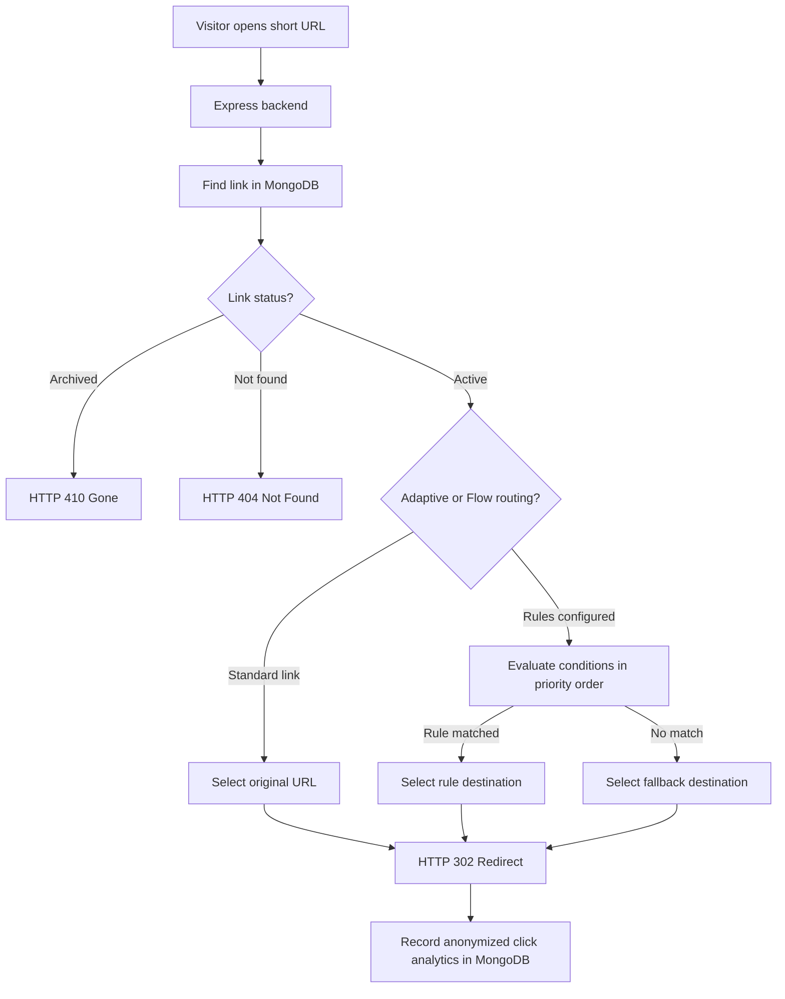

# Linkify

Linkify is a URL shortening and smart link management platform built using the MERN stack (MongoDB, Express, React, Node.js). I initially started this project as a simple URL shortener with QR code generation and click analytics. As the project grew, I wanted to explore how a single link could adapt to different visitor conditions and event schedules without having to create and share a new link every time.

This led to two core features: **Adaptive Links** (rule-based routing by device, country, schedule and UTM parameters) and **Linkify Flows** (a visual workflow builder that schedules different destinations across the lifecycle of an event).

**Live application:** https://linkify-3jnh.vercel.app

## What is Linkify intended for?

Linkify is designed for event organizers, content creators, marketing teams and small businesses who want to manage shared links from a single dashboard.

A practical example is a college festival or conference:
- Organizers can print a single QR code on physical banners, posters and badges weeks before the event.
- **Before the event:** The link redirects visitors to a registration or ticket page.
- **During the event:** The same link automatically redirects visitors to the live stream, schedule or venue map.
- **After the event:** The link redirects visitors to recordings, photos or a feedback form.

The short URL and printed QR code stay exactly the same. No one has to reprint posters, update social media bios or send out replacement links.

## Features

- **URL shortening and custom aliases:** Shorten long URLs into clean links or custom aliases (3–40 alphanumeric characters). If an alias is already taken, Linkify suggests available alternatives.
- **QR code generation:** Generate high-resolution QR codes for any short link and download them directly as PNG images.
- **Link dashboard:** Search, filter, edit, archive and restore links. Soft-archiving a link returns HTTP 410 Gone, and restoring it immediately re-enables redirection.
- **Privacy-preserving click analytics:** Track total clicks, daily traffic, devices (mobile, desktop, tablet), browsers, operating systems, referring websites and approximate geographic locations. To protect user privacy, raw IP addresses and raw User-Agent strings are never stored in the database. Click records automatically expire after 365 days via MongoDB TTL indexes.
- **Adaptive Links:** Route visitors based on multiple criteria evaluated in priority order:
  - Device type (mobile, desktop, tablet)
  - Country (approximate lookup via local DB-IP City Lite database)
  - Time schedules with timezone awareness
  - Campaign UTM parameters (`utm_source`, `utm_medium`, `utm_campaign`)
- **Linkify Flows (Event-driven visual workflows):**
  - Interactive canvas built with React Flow (`@xyflow/react`) to connect entry points, routers, time-based stages and fallback destinations.
  - Event schedule configuration with timezone support and automatic handling of daylight saving time transitions.
  - Built-in routing simulator to test how visitors will be routed at different dates and times before publishing, without recording clicks.
  - Atomic publication using MongoDB transactions to generate a live short link and save an immutable publication snapshot.
  - Publication history with database-side pagination to inspect past snapshots, compare configurations and roll back to earlier versions.
  - Historical flow analytics showing click distribution across destinations.
  - Full flow lifecycle control: archive a flow to pause redirection (HTTP 410) and restore it at any time (HTTP 302).
- **Admin authentication:** Management features are protected by session-based authentication with HttpOnly cookies (`SameSite=Lax; Secure` in production) and scrypt password hashing. Public link redirects and health checks remain accessible without login.
- **Rate limiting and security:** Built-in rate limiters protect link creation, alias checking, flow mutations, analytics queries and login attempts against abuse.

## Tech stack

| Technology | Purpose |
| --- | --- |
| MongoDB / MongoDB Atlas | Primary database for links, click events, flows, publication history and admin sessions |
| Express.js | Backend REST API, routing logic, rate limiting and redirect handling |
| React 18 | Frontend user interface |
| Node.js (Node 24) | Backend JavaScript runtime |
| Vite | Frontend development server and production bundler |
| Tailwind CSS v4 | Styling and responsive design |
| Mongoose | Object data modeling and schema validation |
| React Flow (`@xyflow/react`) | Interactive node-based canvas for Linkify Flows |
| `qrcode.react` | SVG and canvas QR code rendering |
| DB-IP City Lite / `maxmind` | Local MaxMind DB reader for approximate geographic lookups |
| Playwright | End-to-end browser testing and screenshot verification |
| Node.js test runner (`node --test`) | Built-in test runner for backend and frontend unit tests |
| Vercel | Production frontend hosting with reverse proxy for API requests |
| Render | Production backend web service hosting the Express API and redirects |

## Folder structure

The project is structured as an npm workspace containing separate `client` and `server` packages:

```text
linkify/
├── client/                      # React frontend application
│   ├── src/
│   │   ├── components/          # Reusable UI components
│   │   │   ├── FlowWorkspace.jsx    # React Flow builder workspace
│   │   │   ├── FlowNode.jsx         # Custom canvas nodes
│   │   │   ├── FlowInspector.jsx    # Node and stage property editor
│   │   │   ├── FlowSimulator.jsx    # Interactive flow preview simulator
│   │   │   ├── FlowTimeline.jsx     # Visual schedule timeline
│   │   │   ├── FlowAnalytics.jsx    # Flow-level analytics breakdown
│   │   │   ├── FlowHistory.jsx      # Snapshot history and rollback UI
│   │   │   ├── LinkDashboard.jsx    # Link list, search, filters and metrics
│   │   │   ├── AdaptiveRuleEditor.jsx # Rule builder for adaptive links
│   │   │   └── QrCode.jsx           # QR code preview and PNG export
│   │   ├── pages/
│   │   │   └── App.jsx          # Main application page and auth state
│   │   ├── utils/               # Frontend helpers, validation and API fetch wrappers
│   │   ├── styles.css           # Global stylesheet and Tailwind imports
│   │   └── main.jsx             # React DOM entry point
│   ├── test/                    # Frontend unit and component tests
│   ├── vite.config.js           # Vite build configuration
│   └── package.json
├── server/                      # Express backend application
│   ├── src/
│   │   ├── config/              # Database connection setup
│   │   ├── middleware/          # Admin authentication, cookies and CORS checks
│   │   ├── models/              # Mongoose schemas (Link, Flow, ClickEvent, etc.)
│   │   ├── routes/              # API endpoints and public redirect handler
│   │   ├── services/            # Business logic (flow publishing, intelligence, analytics)
│   │   ├── utils/               # Timezone math, click classification, normalization
│   │   ├── app.js               # Express application and route registration
│   │   └── index.js             # Server startup and environment validation
│   ├── scripts/                 # Maintenance, password hashing and testing scripts
│   ├── test/                    # Backend API, compiler and MongoDB integration tests
│   └── package.json
├── .env.example                 # Template for environment configuration
├── vercel.mjs                   # Vercel build-time reverse proxy configuration
├── package.json                 # Monorepo root workspace configuration
└── README.md
```

## How the backend works

The frontend communicates with the Express backend over JSON endpoints. The backend handles request validation, authentication, link resolution, routing evaluation and database updates.

When a visitor opens a shortened URL:
1. The backend extracts the short code and looks up the active link record in MongoDB.
2. If the link is archived, the server returns an HTTP 410 Gone response.
3. If the link is active and uses adaptive routing or a flow, the server checks the visitor context (device, country, simulated or current timestamp, and UTM parameters) against the configured rules.
4. The server selects the matching stage destination, or falls back to the default URL if no rules match.
5. The visitor receives an immediate HTTP 302 redirect to the destination URL.
6. The click event is asynchronously recorded with anonymized metadata (device, browser, operating system, referrer hostname, approximate country and city).



### Main backend services

| Service | File | Responsibility |
| --- | --- | --- |
| Flow compiler | `flowCompiler.js` | Converts visual React Flow graphs into deterministic routing rules |
| Flow service | `flowService.js` | Handles flow creation, draft revisions, validation and listing |
| Flow publishing | `flowPublishingService.js` | Executes atomic publish, rollback, archive and restore in MongoDB transactions |
| Flow intelligence | `flowIntelligenceService.js` | Powers routing simulation, publication history pagination and destination analytics |
| Adaptive routing | `adaptiveRoutingService.js` | Evaluates device, country, schedule and UTM conditions on incoming clicks |
| Link service | `linkService.js` | Generates short codes, validates aliases and suggests alternatives |
| Analytics service | `analyticsService.js` | Aggregates daily trends, device shares, referrers and geographic rankings |
| GeoIP service | `geoIpService.js` | Maps IP addresses to approximate city and country using the local MMDB file |

### Database models

- **Link (`Link.js`):** Stores the short code, default destination URL, title, tags, status (`active` or `archived`), click counter and any inline adaptive routing rules. Has a unique index on `shortCode`.
- **ClickEvent (`ClickEvent.js`):** Stores anonymized click metadata, matched destination ID and timestamps. Uses a compound index `{ linkId: 1, clickedAt: -1 }` for fast analytics and a TTL index on `clickedAt` that expires documents after 365 days.
- **Flow (`Flow.js`):** Stores the event name, creator timezone, event schedule, visual draft graph (`nodes` and `edges`), current draft revision, active publication sequence and active published snapshot.
- **FlowPublication (`FlowPublication.js`):** Dedicated collection storing immutable historical snapshots of published flows. Indexed with a unique compound index `{ flowId: 1, publicationNumber: -1 }`.
- **AdminSession (`AdminSession.js`):** Stores hashed session tokens with credential versions and an automatic TTL expiry index (8 hours).

Flow publication and rollback use MongoDB multi-document transactions to ensure that the link destination, flow document and publication snapshot are updated together.

### API endpoints

#### Public endpoints

| Method | Endpoint | Description |
| --- | --- | --- |
| GET | `/:code` | Redirects to destination URL (HTTP 302) or returns 410 if archived |
| GET | `/api/health` | Service and database readiness probe |

#### Authentication

| Method | Endpoint | Description |
| --- | --- | --- |
| POST | `/api/auth/login` | Admin login with username and password (sets HttpOnly cookie) |
| POST | `/api/auth/logout` | Clears admin session and cookie |
| GET | `/api/auth/session` | Checks current admin session status |

#### Link management (requires admin session)

| Method | Endpoint | Description |
| --- | --- | --- |
| POST | `/api/links` | Create a short link or adaptive link |
| GET | `/api/links` | List links with pagination, search query, status and tag filters |
| GET | `/api/links/:id` | Get link details and configuration |
| PATCH | `/api/links/:id` | Update link destination, adaptive rules, tags, title or status |
| DELETE | `/api/links/:id` | Delete a standalone link |
| GET | `/api/aliases/:alias/availability` | Check if an alias is available and get suggestions if taken |

#### Analytics (requires admin session)

| Method | Endpoint | Description |
| --- | --- | --- |
| GET | `/api/analytics/overview` | Overall dashboard metrics, trends, top links and countries |
| GET | `/api/links/:id/analytics` | Detailed analytics for an individual link over a date range |

#### Linkify Flows (requires admin session)

| Method | Endpoint | Description |
| --- | --- | --- |
| GET | `/api/flows` | List all event flows |
| POST | `/api/flows` | Create a new event flow draft |
| GET | `/api/flows/:id` | Get flow details, draft graph and active publication status |
| PUT | `/api/flows/:id` | Save draft changes (increments draft revision) |
| POST | `/api/flows/:id/publish` | Atomically publish draft to a short link (with custom alias support) |
| POST | `/api/flows/:id/simulate` | Test routing for a given timestamp without writing to the database |
| GET | `/api/flows/:id/history` | Paginated publication snapshot history |
| GET | `/api/flows/:id/diff` | Compare draft or snapshots to inspect routing changes |
| POST | `/api/flows/:id/rollback` | Atomically restore an earlier publication snapshot |
| GET | `/api/flows/:id/analytics` | Flow destination click attribution analytics |
| POST | `/api/flows/:id/archive` | Archive flow (turns live short URL into HTTP 410 Gone) |
| POST | `/api/flows/:id/restore` | Restore flow (re-enables live HTTP 302 redirection) |

## Getting started locally

### 1. Prerequisites

- **Node.js:** Node 24 is recommended (Node 20 or newer is supported).
- **npm:** Included with Node.js.
- **Git:** For cloning the repository.
- **MongoDB:** A local MongoDB replica set or a free MongoDB Atlas cluster. A replica set is required for the multi-document transactions used by Flow publishing and rollback.

### 2. Clone and install dependencies

```bash
git clone https://github.com/midatbest-core/linkify.git
cd linkify
npm install
```

### 3. Set up environment variables

Copy `.env.example` to `server/.env`:

```bash
cp .env.example server/.env
```

Here is a summary of the environment variables used by the project:

| Variable | Used by | Purpose | Local development default |
| --- | --- | --- | --- |
| `PORT` | Server | Port the Express server listens on | `5000` |
| `MONGODB_URI` | Server | MongoDB connection string (replica set recommended) | `mongodb://127.0.0.1:27017/linkify` |
| `CLIENT_ORIGIN` | Server | Allowed frontend origin for CORS | `http://localhost:5174` |
| `SHORT_BASE_URL` | Server | Public base URL used when constructing short links | `http://localhost:5000` |
| `VITE_API_URL` | Client | API origin used by the frontend | `http://localhost:5000` |
| `ADMIN_USERNAME` | Server | Admin username for the dashboard | (choose your own username) |
| `ADMIN_PASSWORD_HASH` | Server | scrypt-hashed admin password | (generate using helper script) |
| `TRUST_PROXY_HOPS` | Server | Number of reverse proxy hops to trust (`0` locally, `1` on Render) | `0` |
| `GEOIP_DB_PATH` | Server | Path to local DB-IP City Lite MMDB file | `./data/dbip-city-lite-2026-11.mmdb` |

### 4. Generate admin password hash and prepare GeoIP data

Linkify does not store plain-text passwords. Generate an scrypt password hash using the built-in helper script:

```bash
npm run hash-admin-password --workspace server
```

The script prompts for a password and outputs an encoded hash in the format `scrypt$<salt>$<hash>`. Copy that value into `ADMIN_PASSWORD_HASH` in `server/.env`.

Next, download the local DB-IP City Lite database file for geographic analytics:

```bash
npm run prepare-geoip --workspace server
```

This downloads and verifies the official DB-IP Lite MMDB file into `server/data/`.

### 5. Start the development server

Start both the frontend and backend together using the workspace root command:

```bash
npm run dev
```

- **Frontend:** http://localhost:5174
- **Backend API:** http://localhost:5000
- **Health check:** http://localhost:5000/api/health

To run them in separate terminal windows:

```bash
# Terminal 1: backend
npm run dev --workspace server

# Terminal 2: frontend
npm run dev --workspace client
```

## How to use Linkify Flows

1. **Log in:** Open the dashboard at http://localhost:5174 and log in with your admin credentials.
2. **Create a Flow:** Navigate to the **Flows** tab and click **Create Flow**.
3. **Set the event schedule:** Set the event timezone (e.g. `Asia/Kolkata`) and local start and end times.
4. **Build the visual graph:**
   - The canvas displays an Entry node, a Router node, scheduled stage nodes (Before, During, After) and a Fallback node.
   - Click any destination node to configure its label and target URL.
5. **Simulate routing:** Open the **Simulator** tab to test where visitors will be redirected at different dates and times.
6. **Publish:** Click **Publish Flow**. Optionally assign a custom short alias (e.g., `fest2026`). The server atomically creates the short link and saves a publication snapshot.
7. **Share the link:** Share the generated short link or download its QR code.
8. **View analytics & history:** Check the **Analytics** tab to monitor click distribution across stages, or inspect past snapshots in the **History** tab and roll back if needed.

## Testing and verification

The repository includes comprehensive test suites across unit, integration and browser levels:

```bash
# Run all unit and in-memory integration tests (client and server)
npm test

# Run MongoDB replica-set integration tests (requires local or Atlas replica set)
node server/scripts/runReplicaSetTests.js

# Run Atlas database schema and index verification
npm run verify-atlas --workspace server

# Run the full Playwright browser verification suite (desktop and mobile)
node server/scripts/verifyAndCaptureMilestone4.js
```

To create a production build of the frontend:

```bash
npm run build
```

To run the backend in production mode:

```bash
npm start
```

## Deployment architecture

The production application is deployed across three services:

1. **Frontend (Vercel):** Hosted at https://linkify-3jnh.vercel.app.
   - Built using Vite with Node 24.
   - The `vercel.mjs` configuration sets up a reverse proxy rewriting `/api/:path*` directly to the backend. This enables same-origin cookies and avoids cross-site cookie restrictions in modern browsers.
2. **Backend (Render):** Hosted at https://linkify-whvp.onrender.com.
   - Runs the Express API and handles public short link redirects.
   - Configured with `TRUST_PROXY_HOPS=1`. GeoIP reads the `CF-Connecting-IP` header provided by Cloudflare.
   - During build, Render runs `npm run prepare-geoip --workspace @linkify/server` to download and checksum-verify the DB-IP database.
3. **Database (MongoDB Atlas):**
   - Cloud-hosted replica set supporting multi-document transactions.
   - Indexed for high performance on short codes, session TTLs, click event analytics and publication history.

## About the project

I built Linkify as part of my web development fellowship at DeepCytes Cyber Labs. The goal was to build a production-ready, full-stack application from scratch and learn practical software engineering patterns along the way.

Building this project taught me a lot about:
- Designing clean REST APIs and data schemas.
- Working with visual node graphs and reactive UI state in React.
- Implementing atomic operations and concurrency control with MongoDB transactions.
- Managing timezone conversions and edge cases like daylight saving transitions.
- Anonymizing analytics data to respect visitor privacy.
- Setting up same-origin authentication proxies across separate frontend and backend hosting providers.
- Writing thorough automated tests and maintaining stable baseline checkpoints during iterative development.

## Acknowledgements

- Geographic lookup data provided by [DB-IP](https://db-ip.com/) under the CC BY 4.0 license.
- Node graph visualization powered by [React Flow](https://reactflow.dev/) (`@xyflow/react`).
